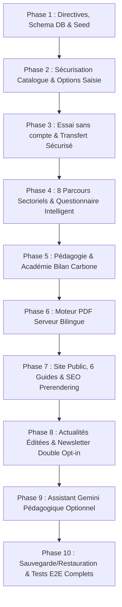

# Plan de Finalisation et d'Exécution — Atlas Carbone

**Version :** 2.0  
**Date d'établissement :** 20 octobre 2026  
**Objectif :** Transformer le prototype Atlas Carbone en une plateforme logicielle professionnelle, bilingue, étanche, pédagogique et rigoureuse pour les entreprises marocaines.

---

## 1. Audit Réalisé et Écarts Identifiés

| Domaine | État Existant | Écart à Combler |
|---|---|---|
| **Catalogue Facteurs** | 670 facteurs extraits du classeur Excel dans `data/catalog_seed.json` | 1) `GET /api/factors` expose toutes les valeurs à tout utilisateur authentifié (doit être réservé à `super_admin`). 2) Manque d'un endpoint `catalog-options` sécurisé retournant libellé/unité/conseil sans valeur interne. 3) Prise en charge explicite des « Postes identifiés, non quantifiés » sans forcer un zéro. |
| **Parcours Essai Invité** | Démo avec identifiants préremplis | Manque d'un vrai essai sans compte (« Essayer sans compte ») avec session isolée (token TTL), calculs réels, téléchargement de rapport préliminaire et transfert sécurisé du dossier vers un compte permanent (« Créer mon compte et conserver mon bilan »). |
| **Questionnaire & Secteurs** | Assistant onboarding générique | Manque des 8 profils sectoriels marocains guidés (Textile, Agroalimentaire, Métallurgie/MACF, Transport, Construction, Hôtellerie, Services, Agriculture) avec vocabulaire courant, explications méthodologiques et justificatifs types. |
| **Pédagogie & Formation** | Non intégré | Manque de l'Académie intégrée (10 micro-modules basés sur le support FM6E/ADEME/ABC fourni, glossaire bilingue, distinction calcul interne vs audit ISO 14065). |
| **Génération PDF** | `window.print()` côté client | Manque d'un générateur PDF officiel côté serveur (PDFKit), versionné, bilingue FR/EN, téléchargeable de façon sécurisée. |
| **Bilinguisme (FR/EN)** | Application essentiellement en français | Manque d'une infrastructure i18n complète : routes `/fr/` et `/en/`, messages serveur, rapports PDF, switch linguistique avec conservation de session et de saisie. |
| **Site Public, SEO & Contenus** | Landing page unique | Manque de pages publiques statiques/prerendered avec métadonnées SEO réelles, 6 guides piliers originaux, espace éditorial d'actualités (brouillon -> publication) et newsletter avec double opt-in et désinscription. Coordonnées réelles d'Abdelaziz Motiaa (`abdelaziz.motiaa@gmail.com`, `+212671581167`). |
| **Assistant Gemini** | Non intégré | Intégration d'un assistant purement consultatif et facultatif avec repli gracieux sans clé API, zéro accès direct aux écritures en base ni altération du moteur mathématique. |
| **Tests & Preuves** | 13 tests numériques + 5 tests sécurité | Extension à une suite complète validant les 16 scénarios d'acceptation requis par le prompt maître (essai sans compte, conversion, profils sectoriels, non-quantifié, bilinguisme, isolation, PDF, newsletter, etc.). |
| **Base de Données & Exploitation** | SQLite WAL opérationnel | Procédure et script automatisé de sauvegarde immuable et test réel de restauration. |

---

## 2. Feuille de Route d'Exécution

---

## 3. Détail des Jalons

### Jalon 1 : Base de données, schémas relationnels & tables de données
- Ajouter tables `guest_sessions`, `news_articles`, `guides`, `newsletter_subscribers`, `dossier_reviews`, `unquantified_activities`.
- Mettre à jour `server/src/db/database.ts` et `server/src/db/seed.ts` avec les données initiales (6 guides piliers, actualités sectorielles, 10 modules pédagogiques).

### Jalon 2 : Confidentialité stricte du catalogue & Endpoint d'options d'activités
- Protéger `GET /api/factors` : accessible uniquement si `req.user?.is_superadmin`.
- Créer `GET /api/activities/catalog-options` : accessible à tout utilisateur ou invité, ne retournant aucun facteur numérique interne ni pondération, seulement code, catégorie, libellés FR/EN, unité attendue, et conseils de recherche de données.
- Endpoint d'annexe méthodologique à accès contrôlé (`GET /api/organizations/:orgId/periods/:periodId/methodological-annex`) ne retournant que les sources et versions des facteurs réellement employés.

### Jalon 3 : Parcours « Essayer sans compte » & Récupération sécurisée
- Création de session invitée via `POST /api/trial/start` avec jeton cryptographique et durée de conservation de 7 jours.
- Saisie et calcul déterministe en direct via `POST /api/trial/:sessionId/calculate`.
- Rapport préliminaire téléchargeable précisant la couverture partielle.
- Conversion vers compte permanent via `POST /api/trial/claim` garantissant zéro perte de données et étanchéité multi-tenant.

### Jalon 4 : Questionnaire d'entreprise intelligent & 8 profils sectoriels
- Implémentation du moteur de questions en langage naturel (« Électricité de vos locaux », « Carburant de vos véhicules », etc.).
- Gestion des 4 statuts de réponse : `Oui`, `Non concerné`, `Je ne sais pas encore`, `À compléter`.
- Support des postes non quantifiés enregistrés avec motif sans jamais forcer zéro.
- 8 profils sectoriels marocains paramétrés.

### Jalon 5 : Académie de formation & Pédagogie intégrée
- 10 micro-modules d'apprentissage inspirés de la démarche FM6E/ADEME/ABC avec cas concrets, vérifications et renvois d'action.
- Glossaire bilingue des termes clés du climat et de la comptabilité GES.

### Jalon 6 : Générateur PDF serveur professionnel
- Implémentation de `server/src/core/pdfReport.ts` (moteur PDFKit).
- Génération de documents bilingues FR/EN avec ventilation Scopes 1/2/3, incertitudes, postes non quantifiés, plan d'actions et signature.

### Jalon 7 : Site Public, Référencement & Guides Piliers
- Pages publiques FR et EN avec métadonnées, hreflang réciproques et canonicals.
- 6 guides piliers originaux sur la comptabilité carbone au Maroc.
- Coordonnées officielles d'Abdelaziz Motiaa (`abdelaziz.motiaa@gmail.com`, `+212671581167`).

### Jalon 8 : Espace Éditorial & Newsletter
- Gestion des actualités (statuts draft / published, catégories, dates réelles).
- Newsletter bilingue avec confirmation double opt-in, journal de consentement et lien de désinscription simple.

### Jalon 9 : Assistant Gemini Pédagogique
- Service serveur sécurisé, prompt sandboxé, consultation exclusive, désactivation gracieuse sans clé API.

### Jalon 10 : Tests d'acceptation complets & Validation
- Suite de tests automatisés couvrant l'ensemble des 16 scénarios obligatoires (`server/tests/acceptance_e2e_tests.ts`).
- Script de sauvegarde SQLite WAL et validation de restauration avec intégrité PRAGMA (`scripts/backup_db.ts`, `scripts/restore_db.ts`).
- **Statut final :** 16 / 16 tests validés avec succès (100% PASS). Tous les jalons sont achevés et déployés localement sur `http://localhost:5000`.
